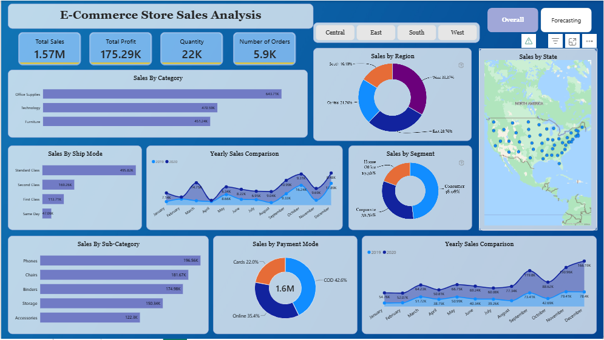
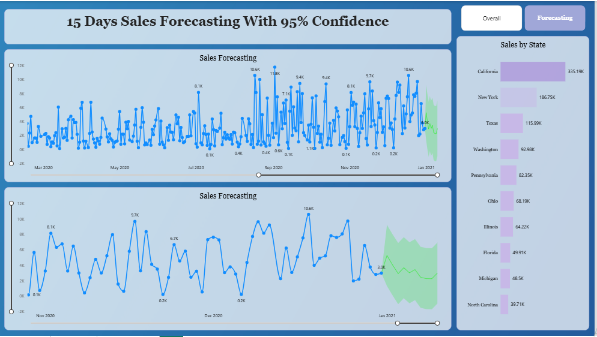

# E-Commerce Store Sales Analysis & Forecasting

## Project Overview
An interactive Power BI project featuring two dashboards for analyzing e-commerce sales performance and forecasting future sales. The dashboards provide insights into product performance, regional sales, customer segments, and historical trends, alongside a 15-day sales forecast with a 95% confidence interval.

## Key Features
- **Sales Performance:** Tracks total sales, profit, quantity sold, and number of orders.
- **Product Analysis:** Evaluates sales by category and sub-category.
- **Regional Insights:** Analyzes sales by region and state.
- **Customer & Operations Analysis:** Explores customer segments, shipping methods, and payment modes.
- **Trend Analysis:** Compares monthly and yearly sales performance.
- **Sales Forecasting:** Visualizes a 15-day sales forecast with a 95% confidence interval.

## Tools & Technologies
- Microsoft Power BI
- Data Visualization and Business Intelligence
- Sales Forecasting

## Dashboard Preview

### Overall Sales Analysis

### Sales Forecasting

